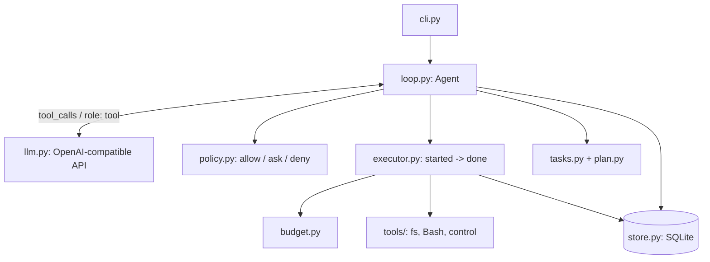

# Coding agent с tool calling

Консольный агент, который получает задачу на изменение небольшого проекта, сам выбирает
инструменты, читает и меняет файлы, запускает тесты и решает, когда закончить работу.

Реализованный уровень: **9 баллов** — agent loop, Bash и файловые инструменты, policy,
восстановление после сбоя, Plan Mode, единый бюджет запуска, задачи с зависимостями.

Готовые агентские фреймворки не используются. Из внешних библиотек только `openai`
(SDK для запросов к модели) и `jsonschema` (проверка аргументов).

## Архитектура



Главный принцип: **модель только предлагает действие, решает runtime.** Цикл (`loop.py`) ничего
не знает о правилах безопасности — каждый вызов проходит через `Policy.check()` в отдельном
модуле, а исполняет его `Executor`, который до и после выполнения сохраняет состояние в SQLite.

| Модуль | Ответственность |
|---|---|
| `agent/loop.py` | цикл агента, пауза и продолжение, подтверждения, план, задачи |
| `agent/policy.py` | проверка путей, команд, фазы и режима |
| `agent/paths.py` | канонизация путей, защита от `..`, абсолютных путей и симлинков |
| `agent/executor.py` | исполнение вызова: списание бюджета, `started`, выполнение, `done` |
| `agent/budget.py` | лимиты и атомарное списание |
| `agent/store.py` | хранилище состояния (SQLite) |
| `agent/plan.py` | схема плана и его проверка |
| `agent/tasks.py` | задачи, зависимости, проверка результата, чеклист |
| `agent/tools/` | инструменты и реестр с JSON Schema |
| `agent/llm.py` | клиент OpenAI-compatible API и фейковая модель для тестов |
| `agent/crash.py` | управляемые точки отказа |

## Установка

Нужны Python 3.10+ и Bash (Linux или macOS).

```bash
git clone <ссылка на репозиторий>
cd coding-agent
python3 -m venv .venv
source .venv/bin/activate
pip install -r requirements.txt
```

## Настройка модели

Подходит любой сервис с OpenAI-compatible Chat Completions API: учебный доступ, сервисы с
бесплатным лимитом или локальная Ollama.

```bash
cp .env.example .env      # впишите свои значения
set -a; source .env; set +a
```

Запасной вариант — Ollama. В одном терминале:

```bash
ollama pull qwen3:4b
ollama serve
```

Во втором:

```bash
export OPENAI_BASE_URL=http://localhost:11434/v1/
export OPENAI_API_KEY=ollama
export OPENAI_MODEL=qwen3:4b
```

## Запуск агента

Все команды выполняются из корня репозитория.

```bash
python -m agent run "Исправь расчёт итоговой стоимости заказа, чтобы тесты проходили. \
Тесты не меняй. Сам найди нужные файлы, внеси исправление и запусти тесты." --mode safe
```

Команда печатает `run_id` — по нему продолжаются все действия с этим запуском.

Параметры `run`:

| Параметр | По умолчанию | Описание |
|---|---|---|
| `--mode safe\|auto` | `safe` | режим исполнения |
| `--no-plan` | выключен | работа без Plan Mode и задач |
| `--workspace` | `workspace` | директория проекта |
| `--policy` | `config/policy.json` | файл policy |
| `--budget` | `config/budget.json` | лимиты бюджета |
| `--bash-timeout` | `30` | таймаут Bash в секундах |

Остальные команды:

```bash
python -m agent status  <run_id>      # статус, бюджет, задачи, что ждёт решения
python -m agent log     <run_id>      # журнал всех tool calls и их попыток
python -m agent tasks   <run_id>      # чеклист задач и подтверждения результатов
python -m agent list                  # все запуски
python -m agent resume  <run_id>      # продолжить запуск
```

### Демо без модели

Чтобы показать полный воспроизводимый прогон без сети, ответы модели можно взять из
готового сценария:

```bash
cp -r workspace /tmp/demo_ws
python -m agent --scripted demo/control_task_script.json run "Исправь расчёт" \
    --mode auto --workspace /tmp/demo_ws
python -m agent --scripted demo/control_task_script.json plan <run_id> --approve
```

Сценарий тот же, что в тестах: в фазе планирования модель пытается изменить файлы
(runtime отклоняет), затем сдаёт план из четырёх задач и выполняет их.

## Инструменты

Каждый инструмент передаётся модели с именем, описанием и JSON Schema аргументов.
Runtime проверяет имя и аргументы до выполнения.

| Инструмент | Тип | Фазы | Повторяемый после сбоя | Назначение |
|---|---|---|---|---|
| `list_files(path)` | read | план, исполнение | да | рекурсивный список файлов |
| `read_file(path)` | read | план, исполнение | да | чтение текстового файла |
| `write_file(path, content)` | write | исполнение | да | создать или полностью перезаписать файл |
| `delete_file(path)` | delete | исполнение | **нет** | удалить файл |
| `Bash(command, cwd)` | bash | исполнение | да | запустить разрешённую команду |
| `submit_plan(...)` | control | план | да | сдать структурированный план |
| `finish_task(task_id, summary)` | control | исполнение | да | заявить о завершении задачи |

Почему так выбрана повторяемость:

- **чтение** не имеет побочных эффектов;
- **`write_file`** записывает файл целиком, поэтому повтор с теми же аргументами даёт тот же
  результат (идемпотентно). Именно поэтому выбран `write_file`, а не `apply_patch`: патч,
  применённый дважды, может испортить файл;
- **`Bash`** разрешает только точные команды из policy, которые не меняют исходники и тесты
  (запуск тестов, `ls -la`, `pwd`); Python запускается с `PYTHONDONTWRITEBYTECODE=1`, чтобы не
  создавать `__pycache__`. Если добавить в `commands.allow` команду, меняющую файлы, это решение
  нужно пересмотреть;
- **`delete_file`** не повторяем: после сбоя неизвестно, что на месте файла, решает пользователь;
- **`submit_plan`** перезаписывает тот же план; **`finish_task`** для уже завершённой задачи
  возвращает сохранённое подтверждение.

Ограничения Bash: таймаут (убивается вся группа процессов), лимит размера вывода, очищенное
окружение (переменные вроде `OPENAI_API_KEY` в дочерний процесс не передаются).

## Режимы safe и auto

| Действие | Plan Mode (до утверждения) | safe | auto |
|---|---|---|---|
| чтение | сразу | сразу | сразу |
| запись, Bash | запрещено | после подтверждения | сразу, если прошло policy |
| удаление | запрещено | после подтверждения | после подтверждения |

## Policy

Файл `config/policy.json` лежит **вне** workspace. Агент не может его прочитать или изменить:
путь вне workspace отклоняется, а сам файл и база состояния дополнительно помечены как служебные.
При запуске policy-файл внутри workspace считается ошибкой конфигурации.

```json
{
  "commands": {
    "allow": ["python3 -m unittest -v", "python3 -m unittest", "ls -la", "pwd"],
    "deny":  ["rm -rf .", "git push"]
  },
  "directories": {
    "allow": ["."],
    "deny":  ["private"]
  }
}
```

Правила:

- **Запрет важнее разрешения**, всё, что явно не разрешено, отклоняется.
- **Команды** — точные строки. Команда проверяется целиком, а не по первому слову. Любой
  синтаксис Bash (`| & ; < > ( ) $ \` \ " ' * ? [ ] { } ~ ! #`, перевод строки) отклоняет
  команду целиком, поэтому конвейеры, подстановки, перенаправления и `bash -c '...'` невозможны.
- **Директории** задаются относительно workspace и при загрузке канонизируются
  (`Path.resolve()`). Директория вне workspace в конфиге — ошибка.
- **Пути от модели** канонизируются (раскрываются `..` и симлинки), абсолютные пути запрещены.
  После этого путь должен лежать внутри workspace, не попадать в `directories.deny` и попадать
  в `directories.allow`. Это касается и `cwd` для Bash.
- Policy перепроверяется **перед каждым исполнением**, а инструменты дополнительно проверяют
  путь и команду сами.

В примере `private/` — запрещённая директория: агент не видит её в `list_files`, не может
читать, писать и запускать в ней команды.

Важно: проверка команд не заменяет изоляцию процесса. Программа, запущенная через Bash,
работает с правами пользователя, поэтому агент нужно запускать на учебной копии проекта без
секретов.

## Plan Mode и утверждение плана

По умолчанию запуск начинается с фазы планирования. Модель видит только `list_files`,
`read_file` и `submit_plan`; любые попытки записи, удаления или Bash отклоняются policy.

План — структурированные данные (хранятся в `runs.plan` вместе с `run_id`):

```json
{
  "goal": "Исправить calculate_total ...",
  "steps": [
    {"id": "T1", "description": "Прочитать order.py и test_order.py",
     "tools": ["read_file"], "depends_on": [],
     "verification": {"type": "files_read", "paths": ["order.py", "test_order.py"]}}
  ],
  "risks": ["..."],
  "assumptions": ["..."],
  "done_criteria": "python3 -m unittest -v завершается с кодом 0"
}
```

Runtime проверяет план: уникальность id, существование зависимостей и инструментов,
отсутствие циклов (алгоритм Кана), соответствие проверок policy. Плохой план возвращается
модели со списком проблем.

```bash
python -m agent plan <run_id>                               # посмотреть план
python -m agent plan <run_id> --approve                     # утвердить и начать исполнение
python -m agent plan <run_id> --reject --reason "..."       # отклонить, модель составит новый
```

Утверждение плана не разрешает действия заранее: в `safe` каждое опасное действие
по-прежнему требует подтверждения.

## Подтверждение действия

Когда policy возвращает `ask`, агент сохраняет состояние, печатает действие (для `write_file`
— с diff) и **завершает процесс**. Решение пользователя продолжает тот же запуск:

```bash
python -m agent approve <run_id> [--call <id>]
python -m agent deny    <run_id> [--call <id>] --reason "не трогай этот файл"
```

После отказа модель получает результат инструмента с причиной и может выбрать другой шаг.
Если в одном ответе модели несколько действий, подтверждение запрашивается по очереди.

## Восстановление по run_id

Всё состояние лежит в `.agent/runs.db` (SQLite): история сообщений, tool calls и их попытки,
решения пользователя, план, задачи, бюджет, журнал событий.

Протокол выполнения каждого вызова (`executor.py`):

1. **транзакция**: проверка и списание бюджета, статус `started`;
2. выполнение инструмента;
3. **транзакция**: результат, статус `done`, сообщение `role: tool`, уточнение бюджета вывода.

Если процесс упал между шагами 1 и 3, при следующем запуске вызов в статусе `started`
считается **неопределённым** (`uncertain`) и молча не повторяется. Пользователь выбирает:

```bash
python -m agent recover <run_id> --retry   # новая попытка того же tool call (только повторяемые)
python -m agent recover <run_id> --fail    # считать шаг неуспешным, модель получит ошибку
python -m agent recover <run_id> --abort   # завершить запуск с ошибкой
```

Повтор оформляется как новая попытка (`attempt = 2`) с тем же `tool_call_id`. Уже
завершённые вызовы никогда не выполняются повторно. Если модель повторяет `tool_call_id`
из прошлого ответа с теми же аргументами, runtime возвращает сохранённый результат без
выполнения; с другими аргументами — ошибку протокола.

Статусы вызова: `proposed → allowed | awaiting_approval → approved → started → done`,
а также `denied`, `rejected_budget`, `uncertain`, `superseded`, `failed`.

Статусы запуска: `running`, `awaiting_plan_approval`, `awaiting_approval`,
`awaiting_recovery`, `model_error`, `finished`, `failed`, `budget_exhausted`.

### Имитация сбоя

```bash
AGENT_CRASH_AT=after_exec python -m agent run "Исправь расчёт" --mode auto --no-plan
python -m agent resume <run_id>            # покажет неопределённый вызов
python -m agent recover <run_id> --retry
```

Точки отказа: `after_model_charge`, `after_start`, `after_exec` (между выполнением инструмента
и сохранением результата). `AGENT_CRASH_NTH=3` — упасть на третьем прохождении точки.
Процесс завершается через `os._exit(137)`, без `finally` и сохранения.

## Бюджет запуска

`config/budget.json`:

```json
{
  "limits": {"model_requests": 40, "tool_calls": 80, "side_effects": 20, "output_bytes": 300000},
  "per_call_output_bytes": 20000
}
```

- Бюджет один на весь `run_id`: планирование, исполнение и восстановление. `resume`,
  утверждение плана и повтор после сбоя счётчики не обнуляют.
- Списание выполняется **до** действия в той же транзакции, что и статус `started`. Если
  процесс упал после списания, бюджет не возвращается.
- Если остатка не хватает на **всю пачку** tool calls из одного ответа модели, не выполняется
  ни один вызов из неё.
- Размер результата заранее неизвестен, поэтому инструмент получает доступный остаток
  (не больше `per_call_output_bytes`), а runtime обрезает вывод и явно помечает его как неполный.
- Не исполнявшиеся вызовы (отклонённые policy, пользователем, ошибки схемы) бюджет
  `tool_calls` не тратят — их ограничивает лимит запросов к модели.
- Когда закончились запросы к модели, tool calls или вывод, запуск получает статус
  `budget_exhausted`.

## Задачи

После утверждения плана каждый шаг становится задачей: `id`, описание, зависимости, состояние
(`pending → in_progress → done`) и проверяемый результат. Runtime запускает задачу только после
завершения всех её зависимостей, задачи выполняются последовательно. Каждый tool call на фазе
исполнения связан с текущей задачей (`tool_calls.task_id`), вызовы планирования хранятся с
`phase = planning` и без `task_id`.

Модель заявляет о завершении через `finish_task`, но **задача становится выполненной только
после проверки runtime** по зафиксированным фактам:

| Проверка | Что проверяет runtime |
|---|---|
| `files_read` | в рамках задачи были успешные `read_file` для этих файлов |
| `file_changed` | хеш файла отличается от хеша на старте задачи |
| `file_unchanged` | хеш файла совпадает с хешем на старте запуска |
| `command_succeeds` | в рамках задачи был запуск этой команды с `exit_code 0`, и после него файлы не менялись |

Подтверждение сохраняется в `tasks.evidence`. После `resume` выполненные задачи заново не
запускаются. При каждом изменении задачи печатаются в stdout чеклистом:

```
- [x] T1: Прочитать order.py и test_order.py
- [ ] T2: Исправить расчёт скидки в order.py (после: T1)  <- в работе
- [ ] T3: Запустить тесты (после: T2)
```

```bash
python -m agent tasks <run_id>
```

## Тесты

```bash
python -m pytest -v
```

Тесты детерминированные: вместо LLM используется `ScriptedLLM` со сценарием, каждый тест
работает на своей копии workspace во временной папке. Контрольный `workspace/test_order.py`
pytest не собирает (см. `pytest.ini`) — его запускает сам агент через Bash.

| Файл | Что доказывает |
|---|---|
| `test_loop.py` | контрольная задача решена, тесты запущены через Bash, `test_order.py` не изменён; несколько tool calls в ответе; ошибки инструментов, неизвестный инструмент, плохой JSON и схема не роняют процесс; таймаут и лимит вывода Bash |
| `test_policy.py` | разрешённая и запрещённая команда, запрет важнее разрешения, конвейеры и `bash -c`, разрешённая команда в запрещённой директории, запрещённая поддиректория для файловых инструментов, `..`, абсолютные пути, симлинки, policy нельзя изменить |
| `test_approval.py` | пауза на подтверждение и продолжение тем же `run_id`, отказ с причиной, удаление в auto, подтверждения по очереди |
| `test_recovery.py` | сбой между выполнением и сохранением результата, `retry`/`fail`/`abort`, запрет повтора неповторяемого, завершённое действие не повторяется, повтор `tool_call_id`, настоящее падение процесса через CLI |
| `test_plan.py` | до утверждения плана нет ни одной операции с побочным эффектом, план структурирован и сохранён, отклонение плана, проверка плана runtime |
| `test_budget.py` | исчерпание каждого лимита, пачка не выполняется частично, счётчики после resume и утверждения плана, сбой между списанием и сохранением результата |
| `test_tasks.py` | 4 задачи с зависимостями, связь вызовов с задачами, чеклист, заявления модели недостаточно, зависимости соблюдаются, после resume выполненные задачи не перезапускаются |

## Ограничения

- Проверка команд не изолирует процесс: Bash работает с правами пользователя.
- Между проверкой пути и операцией с файлом теоретически возможна гонка (TOCTOU); для
  учебного проекта без параллельных изменений это допущение.
- Небольшие локальные модели не всегда правильно заполняют структуру плана; runtime в этом
  случае возвращает модели список проблем, а лимит запросов не даёт циклу длиться бесконечно.
